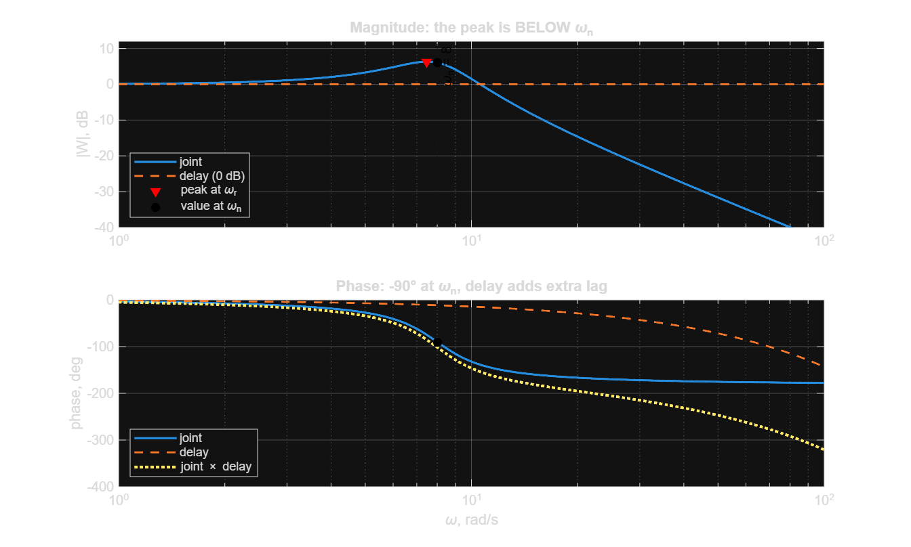
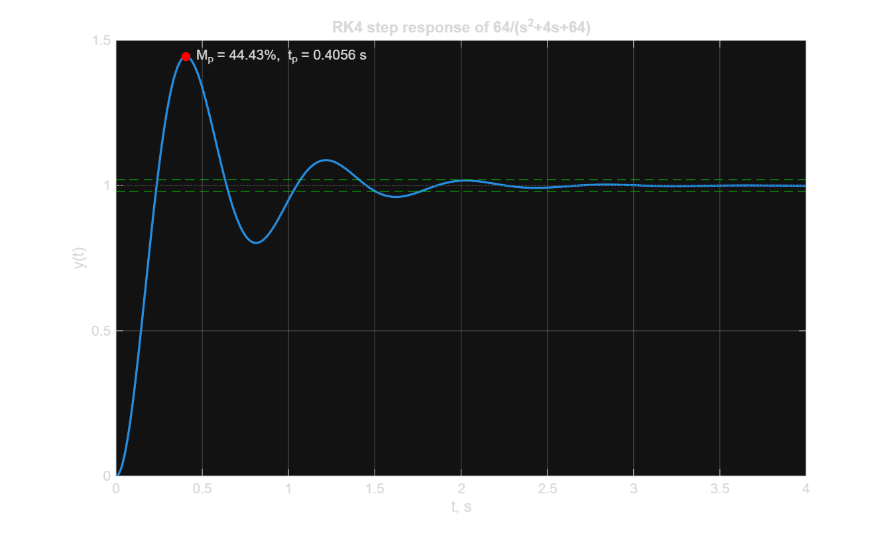

# Lab T2 — Standard Links & Frequency Characteristics — Report

**Course:** M-408-01 Robot Control & Feedback Systems · MSESR (TSI)
**Topic 2 lab:** Time and frequency characterisation of standard dynamic links
**Student name:** Timur Telibaev
**Student ID:** 96823
**Code path:** `/LABT2/`
**Course repo:** https://github.com/iaminanity/M-408-01-robot-control
**Date:** 20 November 2026

---

## 1. Aim

In this lab I characterised the standard dynamic links of a robot joint:
a first-order motor, an integrator, a second-order compliant joint and a
25 ms camera delay. For each link I found the step response and the Bode
magnitude and phase from s = jω. I also connected the links in series and
with negative feedback, and I checked every key result by an independent
method. This matters because the phase of each link later decides the
stability margin of the control loop (Topic 3).

---

## 2. Method

All code uses only base MATLAB R2025b (no Control System Toolbox).

1. **Bode point** — `bode_point.m` puts s = jω into W(s) = num/den and divides
   the *complex* values. The magnitude gives the gain in dB and the angle gives
   the phase in degrees. I divide complex values, not magnitudes, because
   otherwise the phase is lost.
2. **Connections** — series: multiply the polynomials with `conv`
   (`link_series.m`). Negative feedback: W = G/(1+GH), so
   den = dG·dH **+** nG·nH (`link_feedback.m`).
3. **Second-order link** — poles with `roots`; Mp, tp, ts, ωr and Mr from the
   standard formulas; magnitude and phase at ωn with `bode_point`.
4. **Pure delay** — |W| = 1 (0 dB) and phase = −ωτ, computed with `exp(-1j*w*tau)`.
   In series, the dB values add and the phases add.
5. **Verification** — (a) a dense frequency scan (200 001 points,
   `logspace(-1,2,200001)`) and `max` to find the resonant peak independently;
   (b) an RK4 simulation of the step response to measure Mp and tp from the curve.

---

## 3. Results

### 3.1 Headline numbers

| Quantity | Value |
|---|---|
| First-order link 2/(0.1s+1): magnitude / phase at corner ω = 1/T = 10 rad/s | 3.0103 dB (3 dB below DC 6.0206 dB) / −45.0000 deg |
| Integrator 1/s: phase at ω = 1, 10, 100 rad/s | −90 / −90 / −90 deg (constant) |
| Integrator 1/s: magnitude at ω = 1, 10, 100 rad/s | 0 / −20 / −40 dB (−20 dB/decade) |
| Forward path (amp × motor) | 10/(0.1s+1), DC gain 10 |
| Closed loop (H = 1): DC gain / pole | 0.9091 / −110 (corner 110 rad/s vs 10 open-loop) |
| Second-order joint: denominator / poles | [1 4 64] / −2 ± 7.7460j |
| Damped frequency ωd | 7.7460 rad/s |
| Overshoot Mp / peak time tp / 2 % settling | 44.43 % / 0.4056 s / 2.0 s |
| Resonant peak ωr / Mr | 7.4833 rad/s / 6.3009 dB |
| At ω = ωn = 8: magnitude / phase | 6.0206 dB / −90.0000 deg |
| Delay (τ = 25 ms) phase at 10 / 40 / 80 rad/s | −14.324 / −57.296 / −114.592 deg (magnitude 0 dB) |
| Joint × delay at ωn: magnitude / phase | 6.0206 dB / −90 + (−11.4592) = −101.4592 deg |
| Reality-Check 1 (scan): ωr / Mr | 7.4834 rad/s / 6.3009 dB → match |
| Reality-Check 2 (RK4): Mp / tp / final value | 44.43 % / 0.4056 s / 1.0000 → match |

### 3.2 Reading the result

**Resonant peak is not at ωn.** The magnitude peak is at ωr = 7.4833 rad/s
(6.3009 dB), which is lower than ωn = 8 rad/s. At ωn the magnitude is only
6.0206 dB (= 1/(2ζ)), but the phase is exactly −90°, because the real part of
the denominator (ωn² − ω²) becomes zero. The formula ωr = ωn·√(1 − 2ζ²) shows
that ωr < ωn for any real damping; the peak exists only because ζ = 0.25 < 0.707.

**The delay is dangerous.** The 25 ms delay does not change the magnitude
(0 dB at every frequency), but it adds phase lag −ωτ that grows without limit.
At ωn it adds −11.46° for free, so the combined phase becomes −101.46°.
This extra lag reduces the stability margin of the loop.

**Feedback in Part 1.** Unity negative feedback moved the pole from −10 to
−110 rad/s, so the loop became 11 times faster. The DC gain dropped from 10
to 0.9091. Feedback trades raw gain for speed and accuracy.

---

## 4. LLM Co-development Log

| # | Prompt I gave the AI | What it produced | The check I ran | My decision |
|---|---|---|---|---|
| 1 | "Help me do this lab in MATLAB" (gave the lab brief and model solution) | MATLAB code step by step, without Control Toolbox: `bode_point`, `link_series`, `link_feedback`, Part 1 and Part 2 | I typed and ran every step myself and compared each output with the expected output in the lab brief | **Accepted** — all numbers matched |
| 2 | Error: "Unrecognized function or variable 'zeta'" | Said the variable name was spelled differently (keyboard layout / typo) | I re-typed `zeta` in English layout and ran again | **Corrected** — it was my typing error; after the fix (a)–(e) printed correctly |
| 3 | Reality-Check code | Frequency scan (200 001 points + `max`) and RK4 step simulation | Compared scan and RK4 with the closed-form ωr, Mr, Mp, tp | **Accepted** — match = 1; 7.4834 vs 7.4833 is only grid resolution |
| 4 | Report template | The AI noticed the template was for Lab T6, not T2, and adapted the section structure | I checked the T2 brief and the template headings | **Accepted** |
| 5 | Questions to check my understanding | AI asked where the peak is, why the delay is dangerous, what feedback did | I answered; my answer on feedback ("slower, gain up") was wrong. AI showed my own output: pole −10 → −110, gain 10 → 0.909 | **Corrected** my understanding: feedback makes the loop faster and lowers the gain |
| 6 | Help with English and writing the report | AI wrote the English text of the report from our discussion and my answers | I read every sentence and checked that each number is from my own MATLAB output | **Accepted** after checking |

**AI stage for this lab:** Consultant. Every result in this report was produced
by running the code myself and checking it against the lab brief.

---

## 5. Reality-Check evidence

Output of `links_freq.m` (Part 1, MATLAB R2025b):

```text
Step 2  first-order link  K/(Ts+1),  K=2, T=0.1 s
  DC magnitude     = 6.0206 dB
  corner wc = 1/T  = 10.0 rad/s
  |W| at corner    = 3.0103 dB
  phase at corner  = -45.0000 deg
  step y(t=T)      = 1.2642

Step 3  integrator 1/s -- phase is a CONSTANT -90 deg
  w=   1.0 rad/s:  |W| =   0.0000 dB,  phase = -90.0000 deg
  w=  10.0 rad/s:  |W| = -20.0000 dB,  phase = -90.0000 deg
  w= 100.0 rad/s:  |W| = -40.0000 dB,  phase = -90.0000 deg

Step 4  forward path = amp x motor
  num = [10],  den = [0.1           1]
  forward DC gain  = 10.0000

Step 5  closed loop  G/(1+GH),  H=1
  num = [10],  den = [0.1           11]
  closed-loop DC gain = 0.9091
  closed-loop pole    = -110.0000
  closed-loop corner  = 110.0000 rad/s  (vs open-loop 10)
```

Output of `part2.m` (Part 2, MATLAB R2025b):

```text
(a) second-order link  wn=8, zeta=0.25
    num = [64],  den = [1 4 64]
    poles = -2.0000 -7.7460j ,  -2.0000 +7.7460j
    damped freq wd = 7.7460 rad/s

(b) step-response metrics
    overshoot Mp = 44.43 %
    peak time tp = 0.4056 s
    2% settling  = 2.0000 s

(c) frequency response
    resonant freq wr = 7.4833 rad/s
    peak gain Mr     = 6.3009 dB
    at w=wn=8: |W| = 6.0206 dB,  phase = -90.0000 deg

(d) pure delay  e^(-tau s),  tau = 25 ms   (|W| = 0 dB at every w)
    w= 10 rad/s:  |W| = 0 dB,  phase =  -14.324 deg
    w= 40 rad/s:  |W| = 0 dB,  phase =  -57.296 deg
    w= 80 rad/s:  |W| = 0 dB,  phase = -114.592 deg

(e) series joint x delay -- combined response at w = wn = 8 rad/s
    |combined| = 6.0206 dB  (delay adds 0 dB)
    angle      = -90.0000 + -11.4592 = -101.4592 deg

Reality-Check 1: resonant peak by independent frequency scan
    scan  : wr = 7.4834 rad/s,  Mr = 6.3009 dB
    theory: wr = 7.4833 rad/s,  Mr = 6.3009 dB
    match? 1

Reality-Check 2: RK4 time-domain step response
    sim overshoot = 44.43 %  (analytic 44.43 %)
    sim peak time = 0.4056 s  (analytic 0.4056 s)
    sim final value = 1.0000
```





- [x] My code is in `/LABT2/` and runs top-to-bottom in MATLAB.
- [x] The numbers in section 3 are copied from the output above.
- [x] The resonant peak is confirmed by an independent frequency scan.
- [x] Mp and tp are confirmed by an RK4 simulation.

---

## 6. Declaration

I confirm this report and the code at `/LABT2/` are my own work; any AI
assistance is logged honestly in section 4; and the results in section 3
are the real output of the code in section 5.

**Signed:** Timur Telibaev  ·  **Date:** 20 November 2026
